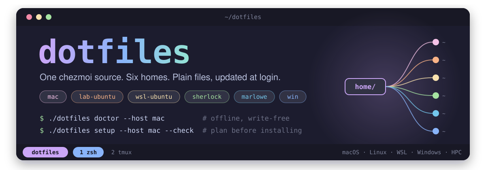
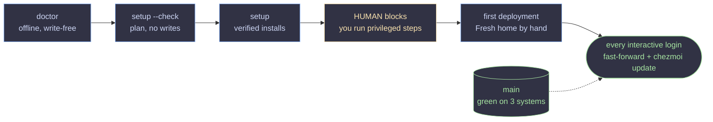
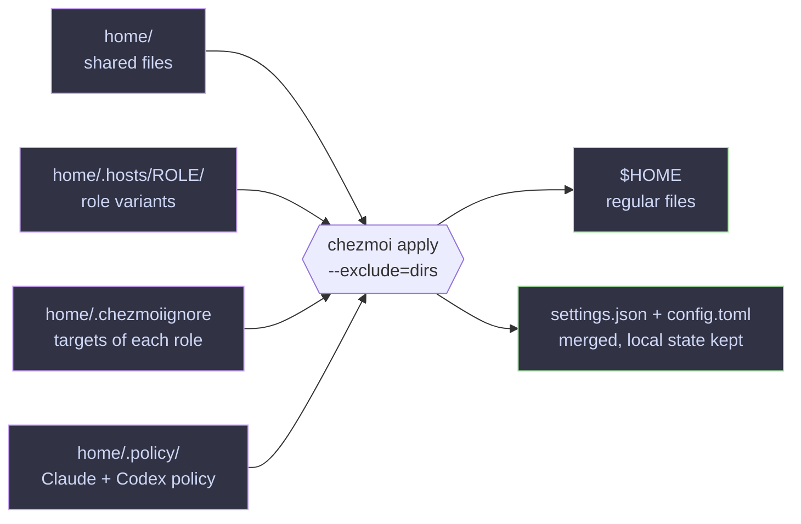

<div align="center">



**Shell, terminal, Git, SSH and AI-agent configuration for macOS, Linux, WSL, native Windows and Stanford HPC,**<br>
**deployed by [chezmoi](https://www.chezmoi.io/) as plain regular files and kept current at every interactive login.**

[](https://github.com/FridrichMethod/dotfiles/actions/workflows/ci.yml)
[](LICENSE)
[](https://www.chezmoi.io/)


**[&#x2728; Highlights](#highlights)** &middot;
**[&#x1F5A5;&#xFE0F; Hosts](#supported-hosts)** &middot;
**[&#x1F680; Quick start](#quick-start)** &middot;
**[&#x2699;&#xFE0F; How it works](#how-it-works)** &middot;
**[&#x1F9F0; What's inside](#whats-inside)** &middot;
**[&#x2328;&#xFE0F; CLI](#command-line)** &middot;
**[&#x1F4DA; Docs](#documentation)** &middot;
**[&#x1F91D; Contributing](#checks-and-contribution)**

</div>

<br>

## Highlights

<table>
<tr>
<td width="33%" valign="top">
<h4>&#x1F4C4; Plain files, one owner each</h4>
chezmoi renders <code>home/</code> into regular files: no symlinks, no daemon, no service. Every target has exactly one source file.
</td>
<td width="33%" valign="top">
<h4>&#x1F3E0; Six homes, one source</h4>
<code>mac</code>, <code>lab-ubuntu</code>, <code>wsl-ubuntu</code>, <code>sherlock</code>, <code>marlowe</code> and <code>win</code> layer a role variant over shared files. Any other Linux takes <code>generic</code>.
</td>
<td width="33%" valign="top">
<h4>&#x1F50D; Look before you leap</h4>
<code>doctor</code> is offline and write-free, <code>setup --check</code> plans without writing, and the first deployment keeps private copies of what it replaces.
</td>
</tr>
<tr>
<td width="33%" valign="top">
<h4>&#x1F511; You hold the keys</h4>
Setup never runs sudo, chsh or a login for you. Privileged steps arrive as <b>HUMAN blocks</b> that you read and run yourself.
</td>
<td width="33%" valign="top">
<h4>&#x1FAB6; Nothing extra to install</h4>
Helpers need only POSIX sh/Bash, the Python 3.11 standard library or PowerShell 7. Setup verifies its installer downloads against pinned SHA256 digests.
</td>
<td width="33%" valign="top">
<h4>&#x1F504; Updates that stay out of the way</h4>
Each interactive login fast-forwards the checkout and applies it. A dirty source or a conflict stops the update with a warning; the shell stays usable.
</td>
</tr>
<tr>
<td width="33%" valign="top">
<h4>&#x1F916; AI agents built in</h4>
Shared Claude Code and Codex guides, permissions and status lines merge into the live config; credentials and host-local state stay put.
</td>
<td width="33%" valign="top">
<h4>&#x1F512; Secrets stay sealed</h4>
Only selected static secrets, age-encrypted and opt-in per home. gitleaks guards commits, and CI scans the whole history.
</td>
<td width="33%" valign="top">
<h4>&#x2705; Tested on three systems</h4>
CI runs on Linux, macOS and native Windows with isolated homes and fake CLIs; fresh-machine bootstrap end-to-end runs weekly and on demand.
</td>
</tr>
</table>

## Supported hosts

Clone once per home. Each home selects its role through an explicit local
`[data].host`, and the checkout stays the source chezmoi reads for every later
update.

| Role | Machine | Notes |
| --- | --- | --- |
| `mac` | &#x1F34E; macOS | Homebrew |
| `lab-ubuntu` | &#x1F52C; Ubuntu desktop | Adds fcitx5 input and X session settings |
| `wsl-ubuntu` | &#x1F427; Ubuntu on WSL | Its own clone, separate from `win`'s |
| `sherlock` | &#x1F332; Stanford Sherlock login node | Ships the `tmux-256color` terminfo entry |
| `marlowe` | &#x26A1; Stanford Marlowe login node | Start tmux from an interactive login shell |
| `win` | &#x1FA9F; Native Windows, PowerShell 7 | 27 regular files and no POSIX shell files |
| `generic` | &#x1F310; Any other Linux | The doctor checks the detected platform without an overlay |

The six hosts, their access rules and their known limits are in
[hosts](docs/hosts.md). The
[PowerShell 7 console procedure](docs/hosts.md#powershell-7-console-acceptance)
distinguishes a real ordinary-user PowerShell console from a noninteractive
task. Genuine [fresh-machine acceptance](docs/bootstrap.md#acceptance-checklist)
is a separate check with its own status.

## Quick start

### macOS, Linux, WSL and HPC

```sh
git clone https://github.com/FridrichMethod/dotfiles.git ~/dotfiles
cd ~/dotfiles
./dotfiles doctor --host mac          # diagnose: offline, writes nothing
./dotfiles setup --host mac --check   # plan: still writes nothing
./dotfiles setup --host mac           # install, then follow the HUMAN blocks
```

Replace `mac` with `wsl-ubuntu`, `lab-ubuntu`, `sherlock` or `marlowe`.

1. &#x1FA7A; **Diagnose.** `doctor` checks each tool against the floor in
   `config/bootstrap/tools.tsv`, offline and without writing.
2. &#x1F5FA;&#xFE0F; **Plan.** `setup --check` prints what setup would do, still offline and
   write-free.
3. &#x1F4E5; **Install.** `setup` installs tools, including verified chezmoi 2.74.0+,
   and prints **HUMAN blocks** for every command it does not run itself:
   sudo, authentication, Slurm allocations and login-shell changes. The floors
   chezmoi's design depends on, and why they hold, are in
   [dependencies](docs/dependencies.md#version-floors).
4. &#x1F6A2; **Deploy.** Follow the HUMAN blocks. H7-deploy points to the first
   deployment, which a new home takes by
   [Fresh home by hand](docs/bootstrap.md#fresh-home-by-hand)
   ([bootstrap playbook](docs/bootstrap.md#h7-deploy-first-apply)): it keeps
   private copies of the files the first apply replaces and stops on anything
   it does not expect at a managed path.

> [!IMPORTANT]
> File apply and login updates use `--exclude=dirs` to preserve existing
> shared parent permissions. Prepare only inspected missing directories
> through the [directory-only procedure](docs/bootstrap.md#preparing-missing-parents);
> a plain apply can change existing parent modes.

> [!WARNING]
> On HPC hosts, build environments only inside a Slurm allocation and never
> under scratch.

<details>
<summary><b>&#x1F427; Another Linux distribution?</b></summary>
<br>

Check with `./dotfiles doctor --platform other` and follow the
[other-Linux procedure](docs/bootstrap.md#x-other-linux-other-linux-distributions);
its `home_deploy generic` writes `[data].host = "generic"` into the local
chezmoi config. setup-host requires a supported explicit host.

</details>

### Native Windows

Use PowerShell 7+ and a Windows-side NTFS clone. WSL keeps a separate clone
and uses the Unix steps above.

```powershell
git clone https://github.com/FridrichMethod/dotfiles.git $HOME\dotfiles
cd $HOME\dotfiles
.\dotfiles.ps1 doctor --host win
.\dotfiles.ps1 setup --host win --check
.\dotfiles.ps1 setup --host win
```

- &#x1F6A2; **Deploy.** Follow the HW-* HUMAN blocks. HW-deploy points to the first
  deployment, which a new home takes by
  [Fresh Windows home by hand](docs/bootstrap.md#fresh-windows-home-by-hand).
  It checks both actual PowerShell profile paths; before it, check the
  ordinary user's ACLs on the destination parents, since a new file inherits
  its parent's ACL.
- &#x1F504; **Update.** Updates write regular files unelevated, without a scheduled task
  or UAC prompt. See [the Windows quick start](docs/bootstrap.md#native-windows)
  and [login updates](docs/updates.md).
- &#x1F9ED; **Find the command.** After deployment, follow the explicit
  [User PATH procedure](docs/bootstrap.md#windows-command-discovery) for bare
  `dotfiles` discovery in a fresh PowerShell 7 process, including
  `-NoProfile`. Before that, use
  `& "$HOME/.local/bin/dotfiles.ps1" doctor --host win`.

### Let an agent drive

Invoke `/dotfiles-bootstrap` in Claude Code or `$dotfiles-bootstrap` in Codex.
The [mirrored project skill](.agents/skills/dotfiles-bootstrap/SKILL.md)
follows the playbook, diagnoses and plans before applying, and hands HUMAN
blocks to you. It never authenticates for you or hides privileged commands in
a script. For a session outside the clone, use the
[agent prompt](docs/bootstrap.md#prompt-for-an-agent-started-outside-the-clone).

## How it works

A home goes from clone to managed in a few explicit steps, then follows `main`
on its own. `main` only ever moves to commits that CI passed on Linux, macOS
and native Windows.



The chezmoi source is `home/` (`.chezmoiroot`). Source names encode `$HOME`
paths and attributes (`dot_`, `executable_`, `private_`, `empty_`). Shared
files come first; the role variant from `home/.hosts/<role>/` follows, read raw
by a one-line role-keyed template.



## What's inside

| | What you get | Read more |
| --- | --- | --- |
| &#x1F41A; **zsh** | oh-my-zsh with Powerlevel10k, fzf-tab, fast-syntax-highlighting, zsh-autosuggestions, you-should-use and zoxide; fzf previews through eza and bat; one POSIX `~/.profile` owns PATH for sh, Bash and zsh | [Unix startup](docs/shell.md#unix-startup) |
| &#x1F5C2;&#xFE0F; **tmux 3.4+** | TPM with resurrect, continuum and tmux-fzf; Catppuccin Mocha, extrakto, yank, a FloaX scratch terminal, a which-key menu, CPU/RAM and battery capsules | [tmux](docs/shell.md#tmux) |
| &#x1F5A5;&#xFE0F; **Terminals** | WezTerm, kitty and Windows Terminal in Catppuccin Mocha with CaskaydiaMono Nerd Font | [Shell startup](docs/shell.md) |
| &#x1F537; **PowerShell 7** | PSReadLine predictions; PSFzf on <kbd>Ctrl</kbd>+<kbd>R</kbd>, <kbd>Ctrl</kbd>+<kbd>T</kbd> and <kbd>Alt</kbd>+<kbd>C</kbd>; an oh-my-posh prompt, zoxide and lazy conda | [PowerShell profile](docs/shell.md#powershell-profile-and-prompt) |
| &#x1F33F; **Git and SSH** | A shared `~/.gitconfig` that includes a per-host `~/.gitconfig_local`; `~/.ssh/config` includes `~/.ssh/config.d/*.conf`, split by concern | [Conventions](AGENTS.md#git-and-ssh-conventions) |
| &#x1F916; **AI agents** | Global Claude Code and Codex guides, portable settings, Codex exec-policy rules and status lines for both | [AI configuration](#ai-assistant-configuration) |
| &#x1F512; **Secrets** | Selected static secrets as builtin-age ciphertext, deployed only to enrolled homes | [Secrets](docs/secrets.md) |
| &#x1F4E6; **Payloads** | coding-agent-kit, PyMOLScripts and awesome-skills, installed by their own installers when you ask | [Payload repos](#payload-repos) |

<details>
<summary><b>&#x1F9E9; tmux notes</b></summary>
<br>

The shared tmux configuration keeps the <kbd>Ctrl</kbd>+<kbd>b</kbd> prefix;
older tmux than 3.4 is unsupported. Plugins are provisioned through
setup-host's S3-clones step; startup installs nothing. Recovery restores
layouts and directories without restarting programs or saving pane contents.
The which-key new-window and split actions preserve quoted paths and literal
tmux formats; regression checks run in Linux CI against tmux 3.4, and their
real-macOS tmux 3.8 coverage is in [hosts](docs/hosts.md#known-limits). See
[tmux setup, keys and limits](docs/shell.md#tmux).

</details>

## Command line

Use `./dotfiles` from a Unix checkout or `.\dotfiles.ps1` from a Windows
PowerShell 7 checkout, even before a home has chezmoi configuration. An
explicit path such as `~/dotfiles/dotfiles doctor --host mac` also works
outside the clone. After deployment, Unix finds `dotfiles` on `~/.local/bin`
in its profile PATH; Windows uses the manual
[User PATH procedure](docs/bootstrap.md#windows-command-discovery).

| Command | Purpose |
| --- | --- |
| `doctor` | Check tools; offline and write-free by default |
| `setup` | Install tools; `--check` plans offline without writes; exit 3 means work remains |
| `payloads sync [ITEM...]` | Install or update selected payload repositories in the foreground |
| `dev test [--ci] [--check-prerequisites]` | Run tests, or check their prerequisites |
| `dev check` | Run `pre-commit run --all-files` from the selected checkout; formatters may edit files and behavior tests run once |
| `help [COMMAND...]`, `--help`, `-h` | Built-in help; runs no backend or installer |

| Command | Both platforms | Unix only | Windows only |
| --- | --- | --- | --- |
| `doctor` | `--host`, `--tier`, `--tsv`, `--quiet`, `--online` | `--platform`, `--smoke`, `--list` | None |
| `setup` | `--host`, `--tier`, `--check`, `--yes`, `--print-manual` | `--only`, `--skip`, `--keep-going`, `--list` | `--what-if`, `--confirm` |
| `dev test` | `--ci`, `--check-prerequisites` | None | None |

> [!NOTE]
> Installed launchers select only the checkout named by the validated home
> `~/.config/chezmoi/chezmoi.toml`; they never select from cwd or a fallback.
> If configuration or the dispatcher is unavailable, including for help,
> recover with `CHECKOUT/dotfiles` or `& CHECKOUT\dotfiles.ps1` explicitly.

<details>
<summary><b>&#x1F9FE; Argument rules and backends</b></summary>
<br>

Every command accepts help. No arguments, bare `payloads`, and bare `dev` show
help and exit 0. Unknown command paths/options, unsupported platform options,
and missing/empty values exit 2 before execution. Use exact lowercase command
and long-option names; values accept `--name VALUE` or `--name=VALUE`. Repeated
scalar values use the last one; booleans are idempotent; Unix `--only`/`--skip`
remain repeatable. `--flag=true` is unsupported. Quote comma lists in
PowerShell: `dotfiles doctor --tier 'core,cli,ai'`. PowerShell arguments must
be strings; raw arrays and objects are rejected with exit 2.

The entrypoint platform determines the backend; `--host win` on Unix does not
start Windows execution. The CLI preserves backend streams and exit codes.
`dev check` accepts no extra pre-commit arguments and does not also run
`dev test`. Neither developer command installs dependencies. Payload defaults,
item validation, upstream lock exit 75 handling, retries and download bounds
remain in the [payload backend](docs/payloads.md); maintenance blocks execution.

The frontends call the native implementations in `scripts/commands/`
directly. Those executable backends are internal; their native parameters
serve focused tests. Root `doctor.sh`, `doctor.ps1`, `setup-host.sh`,
`setup-host.ps1` and `scripts/payload-update.sh` / `.ps1` are retired and
absent, with no shim or fallback. Use the public CLI for every person-run
command.

</details>

## Staying up to date

Each interactive login checks once per session and calls `chezmoi update` with
explicit paths, `--exclude=dirs`, fast-forward-only Git, closed stdin and
conflict handling. It updates only the checkout that
`~/.config/chezmoi/chezmoi.toml` names (its `sourceDir`); a home without that
config runs no updater and prints nothing. See [login updates](docs/updates.md).

- &#x1F6AB; **Refuses** a dirty source, a missing or empty state database and OneDrive
  source writes.
- &#x1FA82; **Fails soft:** failures warn and leave the shell usable.
- &#x23F8;&#xFE0F; **Pauses** while a persistent [maintenance marker](docs/updates.md#maintenance)
  exists, which also blocks explicit payload runs.

| Variable | Effect |
| --- | --- |
| `DOTFILES_AUTO_UPDATE=0` | Disable the dotfiles login updater |
| `DOTFILES_COLOR` | `auto`, `always` or `never`; NO_COLOR/TERM=dumb disable color |

> [!NOTE]
> Set opt-outs before shell startup, and do not run a manual apply while a
> login update runs. Windows Terminal needs a restart to load settings changes.

[Shell startup](docs/shell.md) covers nvm, conda, PATH ordering, PowerShell
key bindings, encoding and prompts. PowerShell checks OneDrive paths and
inherited Git/chezmoi environment prefixes with ordinal case-insensitive
comparisons. Its history secret filter uses culture-invariant matching,
including under Turkish and Azerbaijani cultures, while vendor-specific
case-sensitive patterns retain their behavior.

## AI assistant configuration

The repository [AGENTS.md](AGENTS.md) contains project rules for every agent;
[CLAUDE.md](CLAUDE.md) only imports it. Keep the guide below 28,000 bytes.

| Source | Target |
| --- | --- |
| `home/dot_claude/CLAUDE.md` | `~/.claude/CLAUDE.md`, the user-global Claude Code guide |
| `home/dot_codex/AGENTS.md` | `~/.codex/AGENTS.md`, the user-global Codex guide |
| `home/.policy/claude-settings.json` | Merged into `~/.claude/settings.json` |
| `home/.policy/codex-config.toml` | Merged into `~/.codex/config.toml` |
| `home/dot_codex/rules/portable.rules` | An ordinary file beside the untouched host-local `default.rules` |

- &#x1F500; **Merged, never overwritten.** Claude settings and Codex config are merged
  into mutable regular files with chezmoi's builtin JSON/TOML functions.
  Portable values win while credentials, host-only settings and runtime state
  stay local. Read [AI configuration](docs/ai-config.md) before policy edits.
- &#x1F4BB; **Models stay local.** Claude model selection remains machine-local; its
  effort, plugins and permissions are shared. Codex portable model/reasoning
  defaults live in its tracked config; host-local profile settings are
  preserved.
- &#x1F333; **Worktrees.** Both global guides place persistent agent worktrees in the
  current project's `.worktrees/` directory; brief disposable work may use
  `/tmp`. Keep unfinished work and handoffs in durable storage. After
  integration and validation, release active users and remove completed
  worktrees and their merged task branches. Git ignores `.worktrees/`;
  OneDrive checkouts retain their independent-clone exception.
- &#x1F4CA; **Status lines.** Claude's status-line command enables the
  [coding-agent-kit](https://github.com/FridrichMethod/coding-agent-kit)'s ANSI
  colors for captured output, while preserving an explicit
  `CODING_AGENT_KIT_COLOR` setting; `NO_COLOR` and `TERM=dumb` disable colors.
  The renderer lives in the kit; the command and color preference live in
  dotfiles. The shared Codex CLI status line shows cumulative session tokens,
  alongside model, directory, thread, Git branch, context usage and weekly
  limits. Estimated thread cost appears only when supported by the account
  (Enterprise workspaces in Codex CLI 0.166.0). Edit `tui.status_line` in the
  tracked Codex config to change the shared layout; other TUI preferences
  remain local. A live edit of an owned key stops login updates at that file
  until it is [reconciled](docs/ai-config.md#reconciling-an-owned-key).
- &#x1F6E0;&#xFE0F; **coding-agent-kit.** The kit supplies account launchers, completions and
  Claude helpers on Linux, macOS and WSL. Dotfiles holds only their
  configuration; the kit itself lives in its own repository. Native Windows
  does not install/check the kit: the helper commands run no helper there and
  exit 0; missing Unix helpers fail visibly. Launcher/account operation
  belongs to the kit's own documentation.

> [!CAUTION]
> Authenticate separately on every host. Never commit tokens, histories,
> trust, caches, generated memories or machine-specific absolute paths.

## Payload repos

Three first-party repositories install through their own installers, and only
when a person asks:

| Item | Repository | What it brings |
| --- | --- | --- |
| &#x1F6E0;&#xFE0F; `kit` | [coding-agent-kit](https://github.com/FridrichMethod/coding-agent-kit) | Account launchers, completions and Claude helpers (Linux, macOS and WSL) |
| &#x1F9EC; `pymol` | [PyMOLScripts](https://github.com/FridrichMethod/PyMOLScripts) | PyMOL start-up configuration |
| &#x1F9E0; `skills` | [awesome-skills](https://github.com/FridrichMethod/awesome-skills) | The Claude Code and Codex skill library |

```sh
dotfiles payloads sync [kit] [pymol] [skills]  # foreground: install or update
sync-payloads [kit] [pymol] [skills]           # interactive shortcut
sync-skills                                    # sync-payloads skills
```

`config/payloads.tsv` owns platform selection and the kit channel (currently
0.7). There are no submodules or consumer-side source pins. awesome-skills
manages its own copies under `~/.claude/skills/`, `~/.codex/skills/` and
`~/.agents/skills/awesome-skills/`; Codex reads both of its roots. Selection
and migration stay with that repository's installer.

On native Windows use `dotfiles payloads sync`, these profile functions, or
`& CHECKOUT\dotfiles.ps1 payloads sync` in an ordinary, unelevated PowerShell.
It manages PyMOLScripts and awesome-skills, not the kit. The
[sherlock-kit](https://github.com/FridrichMethod/sherlock-kit) toolkit is
separate: consumer projects pin/install their own.

<details>
<summary><b>&#x1F6E1;&#xFE0F; State, exit codes and download safety</b></summary>
<br>

No login, profile or schedule installs or refreshes the payload repos. A
person runs `dotfiles payloads sync` (or `sync-payloads`), which installs
absent items and updates installed ones in the foreground and keeps no state.
The installed launcher runs the hook of the checkout the validated chezmoi
config names and refuses a config the guard refuses; a home without that
config names no checkout, so run `<checkout>/dotfiles payloads sync`
explicitly.

Exit 75 (another run holds the repository's lock) is no failure. Exit 3 for
configured person-status items requires following the upstream installer's
message; locally edited PyMOL rc files are preserved. Exit 3 and other
failures print a retry line, and the run exits 1. This remains two rolling
PyMOL rc copies, not a version manager. Downloads are bounded and run from
fresh private staging directories, never from a pipe. See the
[payload contract](docs/payloads.md) for bounds, selection, trust and the
usage error any other call gets.

</details>

## Repository layout

| Path | Purpose |
| --- | --- |
| `dotfiles`, `dotfiles.ps1` | Public native frontends: syntax, help and fixed backend dispatch |
| `scripts/commands/` | Internal native doctor, setup and payloads-sync implementations |
| `scripts/chezmoi-update.*` | Stable login lifecycle hooks |
| `lib/` | Shared sourced/imported code; inventories live in `config/` |
| `tests/run.*` | Developer test runners called by `dotfiles dev test` |
| [home](home/) | chezmoi source (`.chezmoiroot`): one file per target under its chezmoi source name (`dot_`, `executable_`, `private_`, `empty_`) |
| `home/.hosts/<role>/` | Role variants of `~/.config/{sh,bash,zsh}` rc files, `~/.gitconfig_local` and `~/.ssh/config.d/legacy.conf`, read raw by one-line role-keyed templates |
| `home/.policy/` | Portable Claude and Codex policy, read raw by the two modify templates |
| `home/.chezmoiignore` | The targets of each role: `generic`, `mac`, `wsl-ubuntu`, `lab-ubuntu`, `sherlock`, `marlowe`, `win` |

chezmoi never deploys a source dot-directory, so `.hosts/` and `.policy/` stay
inputs. Git overrides use `~/.gitconfig_local`; SSH delegates to
`~/.ssh/config.d/*.conf`. A target has exactly one source file; native Windows
deploys 27 regular files and no POSIX shell files. The
[dependency guide](docs/dependencies.md) explains required and optional tools;
`config/bootstrap/` owns installation inventories and versions.

## Documentation

| Guide | Read it for |
| --- | --- |
| &#x1F680; [Bootstrap playbook](docs/bootstrap.md) | Setting up a machine phase by phase, the HUMAN blocks and the first deployment |
| &#x1F5A5;&#xFE0F; [Hosts](docs/hosts.md) | The six homes, how agents reach them, rollout and known limits |
| &#x1F504; [Login updates](docs/updates.md) | What the login update runs, what it refuses, maintenance and adding files |
| &#x1F41A; [Shell startup](docs/shell.md) | zsh, Bash and PowerShell startup, PATH ordering, prompts and tmux |
| &#x1F916; [AI configuration](docs/ai-config.md) | Modify templates, merge ownership and the permission policy |
| &#x1F4E6; [Payload repos](docs/payloads.md) | How dotfiles calls coding-agent-kit, PyMOLScripts and awesome-skills |
| &#x1F512; [Secrets](docs/secrets.md) | Enrolling hosts and secrets with chezmoi's builtin age |
| &#x1F9F1; [Dependencies](docs/dependencies.md) | Required and optional tools and the version floors |
| &#x1F9EA; [Testing](docs/testing.md) | Prerequisites, focused suites, CI and the opt-in bootstrap end-to-end runs |
| &#x1F5FA;&#xFE0F; [Coverage matrix](tests/COVERAGE.md) | Which tests cover which source |

## Checks and contribution

```sh
# Install the selected chezmoi test release, or name an already verified binary:
export DOTFILES_TEST_CHEZMOI=/path/to/chezmoi
pre-commit install
./dotfiles dev test --ci
./dotfiles dev check
pre-commit run --hook-stage manual gitleaks-history
```

Tests use isolated homes and fakes. Native macOS and Windows jobs provide
platform evidence, and Linux CI runs the real-tmux tests with Ubuntu 24.04's
tmux 3.4, the floor, and fails if they would skip
(`DOTFILES_TEST_REQUIRE_TMUX=1`); local skips do not establish native
behavior. The [testing guide](docs/testing.md) explains prerequisites, focused
suites, CI, optional real-kit fixtures and opt-in bootstrap e2e tests. See the
[coverage matrix](tests/COVERAGE.md) for source-to-test mapping.

The [AI configuration](docs/ai-config.md#modify-templates) documents
serialization, preserved Claude/Codex input, exact ownership and refusal of
unsupported inputs. CI requires verified v2.74.0; local chezmoi probes skip if
chezmoi is absent, while an invalid explicit path fails. Enrolling selected
secrets or a host follows [secrets](docs/secrets.md); fixture passes are not
real-host outcomes ([hosts](docs/hosts.md)).

<details>
<summary><b>&#x1F9EA; Windows bootstrap E2E and App Installer</b></summary>
<br>

The hosted Windows bootstrap E2E temporarily pauses only the installed OMP
package's App Installer updates, then verifies restoration. This keeps the
run out of App Installer's unattended update-interaction path, where package
activation can wait after updates resume, while preserving the real package,
doctor assertions and timeouts. It does not validate App Installer update
scheduling or ordinary-user interactive behavior; see the
[runner qualifications](docs/testing.md#host-matrix-and-fidelity).

</details>

### Adding a configuration file

1. Add it under `home/` with its chezmoi source name. A role-specific variant
   goes to `home/.hosts/<role>/<target>` behind a one-line role-keyed
   template; a new template also joins `ROLE_TEMPLATES` in
   `tests/test_chezmoi_source_state.py`. A file containing `{{` stays plain;
   use `.tmpl` only for a real template.
2. Add its row to `tests/fixtures/chezmoi/targets.tsv` and update the counts
   in `tests/chezmoi_source_support.py` (for a shell file also the per-role
   `LINTED` counts in `tests/test_chezmoi_rendered.py`, for a tmux file
   `TMUX_FILES` in `tests/test_tmux.py`).
3. Add a `home/.chezmoiignore` role entry unless it applies to every role.
4. If it introduces a new parent directory, plan the reviewed per-host
   `apply --include=dirs --recursive=false` preparation
   ([Preparing missing parents](docs/bootstrap.md#preparing-missing-parents))
   before landing.
5. Check each applicable host for an existing unmanaged file at the new path:
   the login update stops on it as a first-target conflict until it is
   reconciled ([Editing and adding files](docs/updates.md#editing-and-adding-files)).
6. For a file that applies on Windows, name its parent's ACL model first (see
   [New targets](docs/updates.md#new-targets)).

Every home receives the change through the login update. Keep secrets local,
code in its shell dialect and documentation in English ASCII. Follow
[AGENTS.md](AGENTS.md) for manifest changes, checks and landing policy.

## License

&#x2696;&#xFE0F; [MIT](LICENSE).

<div align="center">
<br>
<sub>&#x1F3E0; One source &middot; six homes &middot; plain files &middot; themed in Catppuccin Mocha &#x1F431;&#x1F49C;</sub>
</div>
